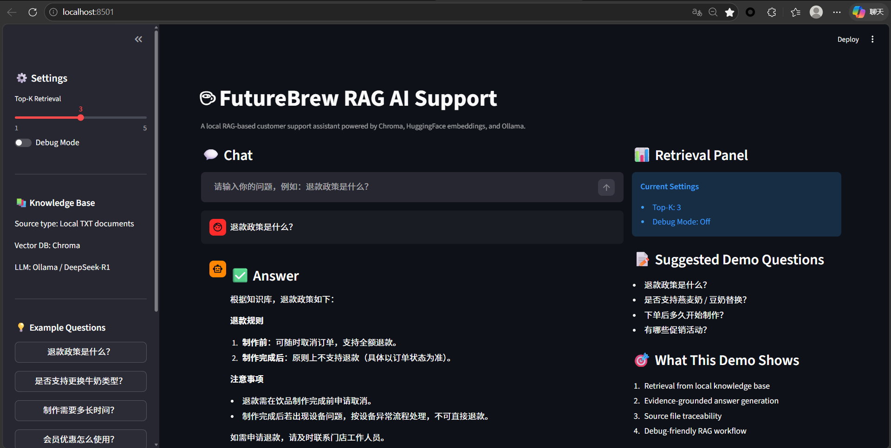
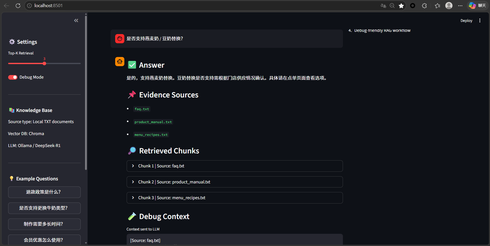
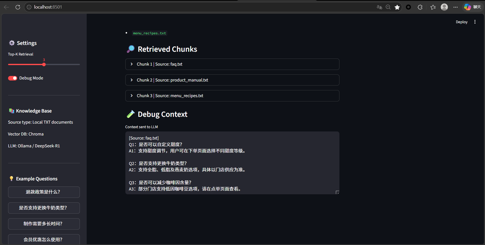

# ☕ FutureBrew RAG AI Support

> A **production-style local RAG AI support demo** for coffee-shop customer service, featuring semantic retrieval, source-grounded answers, and full prompt-context observability.

---

## 🧠 System Architecture


---

## 🖥️ Demo Preview

### 💬 Chat UI Overview



### 🔍 Retrieval Evidence & Source Traceability



### 🧪 Debug Context Observability



---

## 🚀 Project Overview

FutureBrew is a **local Retrieval-Augmented Generation (RAG) AI support system** designed for a simulated coffee-shop customer-service scenario.

The system retrieves relevant business knowledge from a local document corpus and uses a **fully local large language model powered by Ollama + DeepSeek-R1** to generate **evidence-grounded, hallucination-resistant responses**.

Unlike a simple chatbot demo, this project emphasizes:

* 🔍 **semantic retrieval transparency**
* 📌 **source-level evidence traceability**
* 🧪 **LLM input context observability**
* ⚙️ **local-first deployment workflow**
* 🌐 **interactive product-style Streamlit UI**

This makes it highly suitable as an **AI application engineering / RAG system demo project**.

---

## ✨ Core Features

* 📚 Local TXT-based knowledge base
* 🔍 Chroma semantic vector retrieval
* 🧠 HuggingFace embeddings (`BAAI/bge-small-zh-v1.5`)
* 🤖 Fully local inference with Ollama + DeepSeek-R1 8B
* 🌐 Productized Streamlit chat-style UI
* 📌 Evidence source display
* 🧩 Expandable retrieved chunk inspection
* 🧪 Debug Mode for prompt context visibility
* 🎛 Adjustable Top-K retrieval control
* ⚡ Fully local and privacy-friendly deployment

---

## 🔄 RAG Workflow Pipeline

```text
User Query
   ↓
Semantic Retrieval (Top-K)
   ↓
Source Chunk Aggregation
   ↓
Prompt Context Assembly
   ↓
Local LLM Inference (Ollama)
   ↓
Grounded Answer + Evidence + Debug Context
```

---

## 🧱 Project Structure

```text
futurebrew-rag-ai-support/
├── app/
│   ├── __init__.py
│   ├── main.py
│   └── rag.py
├── assets/
│   ├── architecture.png
│   ├── chat-ui-overview.png
│   ├── retrieval-evidence.png
│   └── debug-context-view.png
├── documents/
│   ├── company_intro.txt
│   ├── faq.txt
│   ├── menu_recipes.txt
│   ├── product_manual.txt
│   ├── promotions.txt
│   └── training_guide.txt
├── vector_db/
├── build_vector_db.py
├── split_documents.py
├── test_retrieval.py
├── requirements.txt
└── README.md
```

---

## ⚙️ Environment Requirements

* Python **3.10+**
* Ollama
* Git
* Windows 11 / WSL Ubuntu / macOS
* Recommended RAM: **8GB+**
* Disk space: **3GB+** (for local model + vector DB)

---

## 🚀 Quick Start

### 1) Clone Repository

```bash
git clone <your-repo-url>
cd futurebrew-rag-ai-support
```

---

### 2) Create Virtual Environment

#### Windows

```bash
python -m venv venv
.\venv\Scripts\activate
```

#### Linux / macOS

```bash
python3 -m venv venv
source venv/bin/activate
```

---

### 3) Install Dependencies

```bash
pip install -r requirements.txt
```

---

### 4) Pull Local LLM Model

```bash
ollama pull deepseek-r1:8b
```

---

### 5) Build Vector Database (First Run Required)

```bash
python build_vector_db.py
```

> 📌 This step creates the local Chroma semantic index under `vector_db/`.

---

### 6) Launch Streamlit UI

```bash
streamlit run app/main.py
```

Open browser:

```text
http://localhost:8501
```

---

## 💬 Example Questions

* 退款政策是什么？
* 是否支持燕麦奶 / 豆奶替换？
* 制作需要多长时间？
* 当前有哪些促销活动？
* 会员优惠如何使用？

---

## ⚙️ How It Works

1. Load local business knowledge documents
2. Split documents into semantic chunks
3. Convert chunks into vector embeddings
4. Persist vectors into Chroma DB
5. Retrieve Top-K relevant chunks
6. Aggregate chunk sources
7. Build LLM-ready prompt context
8. Send context to local Ollama HTTP API
9. Generate grounded answer
10. Render answer + evidence + debug context in UI

---

## 🎯 Engineering Highlights

### 🔍 Retrieval Observability

Every response can display:

* evidence source files
* retrieved chunks
* source-level chunk mapping

This improves **trustworthiness and debugging efficiency**.

---

### 🧪 Prompt Transparency

Debug Mode reveals:

* full retrieved context
* exact prompt payload sent into LLM
* chunk ordering behavior

This provides strong **RAG observability engineering signals**.

---

### 🔒 Local-First AI Workflow

The entire pipeline runs locally:

* local embeddings
* local vector DB
* local LLM
* local UI

Ideal for:

* privacy-sensitive demos
* offline AI applications
* low-cost inference workflows

---

## 📌 Tech Stack

* Python
* Streamlit
* LangChain
* Chroma
* HuggingFace Embeddings
* Ollama
* DeepSeek-R1 8B
* Requests
* BAAI/bge-small-zh-v1.5

---

## ⚠️ Common Issues

### 1) Model Not Found

```bash
ollama pull deepseek-r1:8b
```

---

### 2) Empty Retrieval Results

Make sure the vector database is built:

```bash
python build_vector_db.py
```

---

### 3) Port Already In Use

Change Streamlit port:

```bash
streamlit run app/main.py --server.port 8502
```

---

### 4) First Run Is Slow

The first launch may be slower because:

* local model loading
* embedding initialization
* Chroma DB warm-up

Subsequent runs will be significantly faster.

---

## 🔮 Future Improvements

* ⚡ Streaming token output
* 🚀 FastAPI backend refactor
* 👥 Multi-user session support
* 🐳 Docker deployment
* 📊 Retrieval metrics dashboard
* 🧠 Hybrid reranking
* 📁 PDF / DOC knowledge ingestion
* 🔍 Citation confidence scoring

---

## 👤 Author

**Catherine**
AI Engineering · RAG Systems · AI Product Workflow

---

