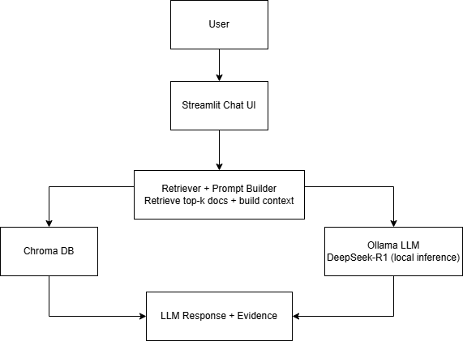

# ☕ FutureBrew RAG AI Support

A local RAG-based customer support assistant built with Streamlit, Chroma, HuggingFace embeddings, and Ollama.

---

## 🧠 System Architecture



---

## 🚀 Overview

This project implements a **local Retrieval-Augmented Generation (RAG)** system for an AI coffee shop customer support scenario.

It retrieves relevant knowledge from a local document database and uses a **local large language model (LLM)** via Ollama to generate structured, evidence-grounded answers.

---

## ✨ Features

* 📚 Local knowledge base (TXT documents)
* 🔍 Semantic retrieval with Chroma vector database
* 🧠 HuggingFace embeddings (bge-small-zh)
* 🤖 Local LLM inference with Ollama (DeepSeek-R1)
* 🌐 Streamlit web UI (chat-style interface)
* 📌 Evidence citation display (expandable)
* 🎛 Adjustable retrieval count
* 🧪 Debug mode (view full context)

---

## 🧱 Project Structure

```text
rag_project/
├── app/
│   ├── __init__.py
│   ├── main.py          # Streamlit chat UI
│   └── rag.py           # RAG pipeline logic
├── documents/           # Knowledge base files
├── vector_db/           # Chroma vector DB (ignored by Git)
├── build_vector_db.py   # Build embeddings
├── split_documents.py   # Text splitting
├── test_retrieval.py    # Retrieval testing
├── requirements.txt
├── README.md
```

---

## ⚙️ How It Works

1. Load local text documents
2. Split into chunks
3. Convert to embeddings
4. Store in Chroma vector DB
5. Retrieve top-k relevant chunks
6. Build context for LLM
7. Send prompt to local LLM (Ollama)
8. Generate structured answer
9. Display answer + evidence in UI

---

## 🖥️ Run the Project

### 1️⃣ Activate virtual environment

.\venv\Scripts\Activate

---

### 2️⃣ Start Ollama (local LLM)

ollama run deepseek-r1:8b

---

### 3️⃣ Launch the web UI

streamlit run app/main.py

Open browser:

[http://localhost:8501](http://localhost:8501)

---

## 💬 Example Questions

* 退款政策是什么？
* 是否支持更换牛奶类型？
* 制作需要多长时间？

---

## 🧾 Example Output

The system returns:

* Structured answer (3 lines)
* Evidence sources from knowledge base

Example:

制作前：用户可在订单生成前取消，全额退款
制作后：已制作订单不支持退款
异常情况/建议：请在制作前及时取消订单

---

## ⚠️ Notes

* venv/ and vector_db/ are excluded from Git
* Ollama must be running before asking questions
* First run may be slower due to model loading

---

## 🔮 Future Improvements

* Faster lightweight models (Qwen, etc.)
* Streaming response output
* Collapsible evidence UI
* FastAPI backend refactor
* Multi-user support

---

## 📌 Tech Stack

* Python
* Streamlit
* LangChain
* Chroma
* HuggingFace Embeddings
* Ollama
* DeepSeek-R1 8B

---

## 👤 Author

Catherine
AI Engineering / System-Oriented Developer
